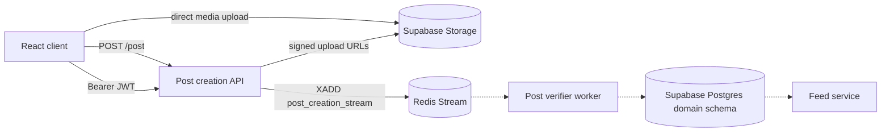

# TatSat

TatSat is a quality-focused discourse network. The repository currently
contains a working frontend prototype and an asynchronous post-submission
backend. The downstream verifier, feed, graph, and personalization services
are still being built.

## Repository layout

| Path | Responsibility | Status |
| --- | --- | --- |
| [`frontend/`](frontend/) | React/Vite client and prototype UX | Implemented prototype |
| [`post_creation/`](post_creation/) | Authenticated media URLs and post queue API | Implemented queue boundary |
| [`post_verifier/`](post_verifier/) | Redis consumer and domain persistence | Scaffolded, worker incomplete |
| [`post_creation_messaging_queue/`](post_creation_messaging_queue/) | Redis stream notes/configuration | Configuration notes |
| [`schema_unified.sql`](schema_unified.sql) | Canonical Supabase/Postgres domain schema | Source of truth |
| [`docs/`](docs/) | Product, ranking, quality, and graph design | Design documentation |
| [`docs/uml/`](docs/uml/) | Mermaid architecture and data-flow sources | Maintained diagrams |

The previous standalone frontend and prototype schema are archived under
`../archive/` and are not active implementation sources.

## Current end-to-end boundary



The solid path is implemented. The dotted path is scaffolded or planned.
Detailed diagrams are in [`docs/uml/`](docs/uml/).

## Database source of truth

Use [`schema_unified.sql`](schema_unified.sql) for database setup and
migrations. It defines the `domain.users`, `domain.posts`,
`domain.post_media`, `domain.post_links`, and `domain.post_links_users`
tables, plus the vector search function.

## Running the frontend

```bash
cd frontend
npm ci
npm run dev
```

The frontend currently expects the post creation API at
`http://127.0.0.1:8000`. Its current limitations are documented in
[`frontend/README.md`](frontend/README.md).

## Running the post creation API

Install [`post_creation/requirements.txt`](post_creation/requirements.txt),
configure Supabase and Redis environment variables, then run:

```bash
cd post_creation
uvicorn server:app --host 127.0.0.1 --port 8000
```

The API exposes:

| Method | Path | Purpose |
| --- | --- | --- |
| `GET` | `/health` | Liveness check |
| `GET` | `/post-media-urls` | Creates four authenticated signed upload URLs |
| `POST` | `/post` | Validates/authenticates and queues a post, returning `202` |

## TODO

### Immediate integration

- [ ] Implement the Redis consumer loop in `post_verifier/main.py`.
- [ ] Connect the consumer to `DatabaseClient.insert`.
- [ ] Add AI analysis, embeddings, topic extraction, and relationship persistence
      to the verifier pipeline.
- [ ] Validate media ownership, object existence, MIME type, and size before
      inserting a post.
- [ ] Transition posts and media from `pending` to `active` or `rejected`.
- [ ] Add retry, consumer-group, acknowledgement, and dead-letter handling.
- [ ] Align the frontend with real Supabase sessions and the `202 queued`
      response.

### Product services

- [ ] Add feed retrieval, pagination, relevance ranking, temporal ranking, DQS,
      contributor score, and visibility score.
- [ ] Add comments/replies and related-content endpoints.
- [ ] Persist and query knowledge-graph links and semantic relationships.
- [ ] Add topic, stance, information-type, evidence-basis, and sentiment labels.
- [ ] Add account lifecycle, follows, preferences, creator metrics, and
      personalized recommendations.

### Operations

- [ ] Add migrations and environment-specific schema validation.
- [ ] Add service-level health checks for Redis, Supabase, and AI providers.
- [ ] Add observability, rate limiting, restricted CORS, and production secret
      management.
- [ ] Add CI coverage for API contracts, queue processing, verifier failures,
      and frontend/backend integration.
