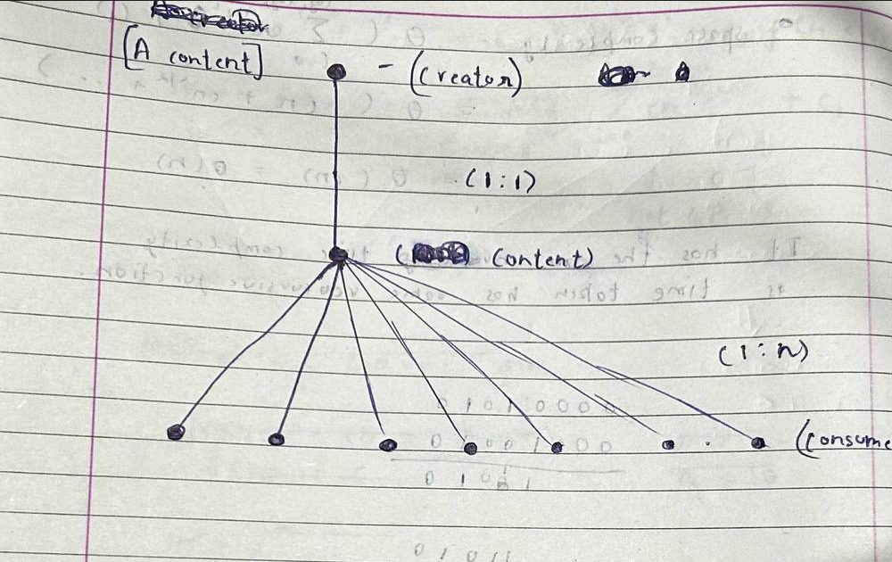

# Terminology

# Content

Anything sent to our server with the intention of it being seen by the public. (other than bio).

Each **content** has at most 1 "**parent-content-id**" and/or at most 4 "**in-post-content-id**".

# 

### Types

**Post:**

Content that does not have a "**parent-content-id**".

**Comment**:

Content that have a "**parent-content-id**" (the user went to a **content's window** and tapped on the make-comment button to make his **content** and intends others to read his **content** with the parent **content**) (the **content** before it can also have a "**parent-content-id**" and that post further can also have a "**parent-content-id"** and so on)

**Reply**:

**Content** that has "**in-post-content-id**".  (reply may not have "**parent-content-id**" (reply can be a **post**) or may have "**parent-content-id"** (reply can be a **comment**)

### Content Window

For every **Content** (A) we display the following information.

**Parents:** If it has a "**parent-content-id**" then that content is displayed. It goes on until the root **post** is reached.

parent-content-id

**In Post:** If it has "**in-post-content-ids**" they are displayed.

in-post-content-id

**Comments: Content** that have "**parent-content-id"** as  A.

**Replies** : **Content** that have  one of the "**in-post-content-id**" as A and have no "**parent-content-id**".

**Links** : **Content** that have no link to A, but contribute to the discourse of A. (We find links using NLP approaches)

### Graphs (Along with Features)

Represents the connection between a Content and the user associated with it. 

### Based on the Content Itself

**1. Content's Topic ( 'I have decided to increase the tariffs on india' - topic : Trump Tariffs, American Politics etc)
2. Content's sub topic ( 'I have decided to increase the tariffs on india' - sub topic : Trump Tariffs on India)
3. Content's edit history**

- **Content's Topic** ( 'I have decided to increase the tariffs on india' - topic : Trump Tariffs, American Politics etc)
- **Content's sub topic** ( 'I have decided to increase the tariffs on india' - sub topic : Trump Tariffs on India)
- **Content's edit history**

**1. Content's Language (do not make small language groups, purpose is to break the language boundary)
2. Content's Location  (where was it posted from) 
3. Content's Timing (when is it posted)**

- **Content's Language** (do not make small language groups, purpose is to break the language boundary)
- **Content's Location** (where was it posted from)
- **Content's Timing** (when is it posted)

**1. Content's DQS**

- **Content's DQS**

### Based on Content's Creator

**1. Content's Creator's Assets
2. Content's Creation Assets
3. 
    1. None (empty category)**

- **Content's Creator's Assets**
- **Content's Creation Assets**
- **None (empty category)**

### Based on the Content's Consumers

**1. Content's Consumers' Assets**

- **Content's Consumers' Assets**

**1. Content's Consumption Assets**

- **Content's Consumption Assets**
- Likes - number, who liked it
- Comments - number, who commented
- Views - numbers, who viewed it
- Re Post - numbers, who re posted
- Saves - number, who saved
- Replies - number, who replied

Ratios of above, view : like ratio etc.

Represents the connection between the a Creator and other users. (does not represent the direct link identified by the followers)

### Based on the Creator Themselves

Profile Information

Bio

DP

Location

Flair

### Based on the Creator's Contents

**1. Creator's Contents' Topics (Each post has topic, but some creators only have one topic like cricket,  some like abhijit have many topics) 
2. Creator's Contents' sub topic ( Within Indian Politics, there could be TN or Karnataka state politics)**

- **Creator's Contents' Topics** (Each post has topic, but some creators only have one topic like cricket, some like abhijit have many topics)
- **Creator's Contents' sub topic** ( Within Indian Politics, there could be TN or Karnataka state politics)

**1. Creator's Contents' Languages (Do not make small language groups, purpose is to break the language boundary)
2. Creator's Contents' Locations  (Political Spokesperson has location in his bio as india, but posts from UK) 
3. Creator's Contents' Timings**

- **Creator's Contents' Languages** (Do not make small language groups, purpose is to break the language boundary)
- **Creator's Contents' Locations** (Political Spokesperson has location in his bio as india, but posts from UK)
- **Creator's Contents' Timings**

**1. Creator's Contents' avg DQS**

- **Creator's Contents' avg DQS**

### Based on the Creator's Contents' Consumers

### 

**1. Creator's Contents' Consumption Assets**

- **Creator's Contents' Consumption Assets**
- Avg, total Likes - number, who liked it
- Avg, total Comments - number, who commented
- Avg, total Views - numbers, who viewed it
- Avg, total Re Post - numbers, who re posted
- Avg, total Saves - number, who saved
- Avg, total Replies - number, who replied

Ratios of above, view : like ratio etc.

### Based on Creator's Consumers

(is not represented in chart, it is a direct connection between creator and consumers)

1. Followers

Represents the connection between a Consumer and other users (does not represent the direct link identified by the followers)

