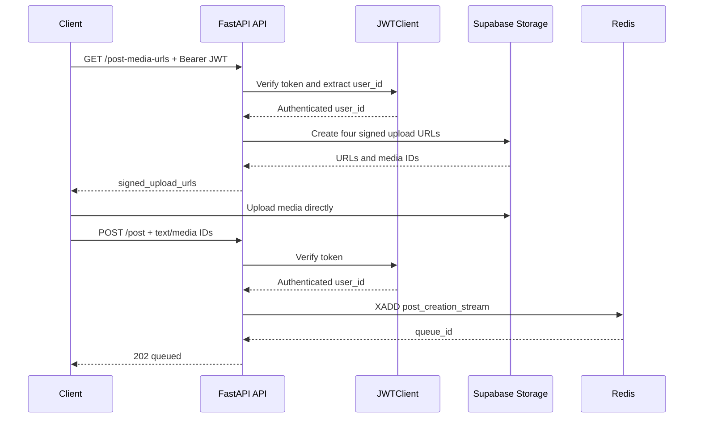

# Post creation service

The post creation service is the authenticated edge of the asynchronous
submission pipeline. It does not insert posts directly. It authenticates the
caller, creates signed upload URLs, validates the request model, and appends a
serialized request to the Redis stream `post_creation_stream`.

## Responsibilities

| Component | Responsibility |
| --- | --- |
| `network/router.py` | HTTP routes, auth error mapping, queue submission |
| `network/request_models.py` | Text, link, media, parent, and visibility validation |
| `security/jwt_client.py` | Supabase JWT verification and user ID extraction |
| `domain/object_storage_client.py` | Four user-scoped signed upload URLs |
| `domain/post_creation_messaging_queue_client.py` | Redis Stream `XADD` producer |
| `server.py` | FastAPI application and CORS middleware |

## API contract

### `GET /health`

Returns:

```json
{"status": "ok"}
```

### `GET /post-media-urls`

Requires a valid Supabase Bearer token. Returns four signed upload URLs. Each
object path is namespaced as `<user_id>/<media_id>`.

### `POST /post`

Requires a valid Supabase Bearer token. Accepts both `text` and the legacy
frontend name `content`. It accepts both `reference_link` and the latest-main
compatibility name `external_link`; both normalize to `reference_link`.

The text limit is 560 characters. Media IDs and media types must have matching
lengths, with at most four entries.

Successful submission returns HTTP `202`:

```json
{
  "status": "queued",
  "message": "Post submitted for processing",
  "queue_id": "redis-entry-id"
}
```

## Request flow



## Environment

Required values are loaded through `python-dotenv`:

- `SUPABASE_PROJECT_URL`
- `SUPABASE_SERVICE_KEY`
- `REDIS_URL`

The service uses the Supabase service client server-side. The service key must
never be exposed to the browser.

## TODO

- [ ] Replace wildcard CORS with configured frontend origins.
- [ ] Add API-level rate limiting and request correlation IDs.
- [ ] Add queue health checks and fail clearly when Redis is unavailable.
- [ ] Add idempotency keys to prevent duplicate submissions.
- [ ] Add integration tests for the `202` queue contract.
- [ ] Add OpenAPI examples for both compatibility field names.
