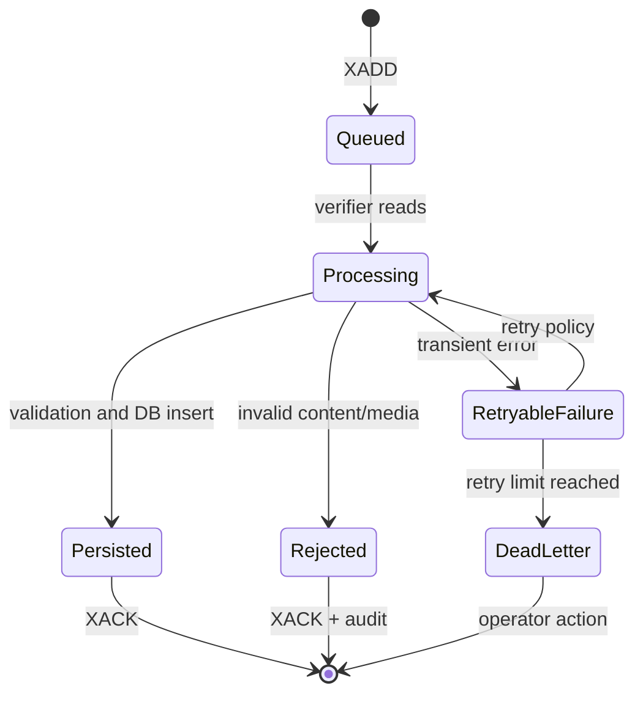

# Post creation messaging queue

Post creation publishes serialized requests to a Redis Stream named
`post_creation_stream`. The producer is implemented in
[`../post_creation/domain/post_creation_messaging_queue_client.py`](../post_creation/domain/post_creation_messaging_queue_client.py).

## Message shape

The producer writes one Redis stream field named `data`. Its JSON value has
this shape:

```json
{
  "user_id": "authenticated-user-uuid",
  "request_body": {
    "text": "validated post text",
    "long_text": null,
    "media_ids": [],
    "media_types": [],
    "reference_link": null,
    "parent_post_id": null,
    "post_user_visibility": "public"
  }
}
```

The Redis entry ID returned by `XADD` is returned to the API client as
`queue_id`.

## Current state

Implemented:

- Redis async client construction.
- `XADD` producer.
- Environment-based `REDIS_URL`.
- Local fallback to `redis://localhost:6379/0` in the verifier helper.

Not yet implemented:

- Consumer groups.
- Explicit acknowledgements.
- Pending-entry recovery.
- Retry and dead-letter streams.
- Queue depth and lag monitoring.
- Idempotency and duplicate-message handling.



## TODO

- [ ] Define a durable consumer-group name and configure it per environment.
- [ ] Replace the helper's `XREAD`/`XDEL` prototype with `XREADGROUP` and
      `XACK`.
- [ ] Add bounded retries and a dead-letter stream.
- [ ] Add queue metrics and operational runbooks.
