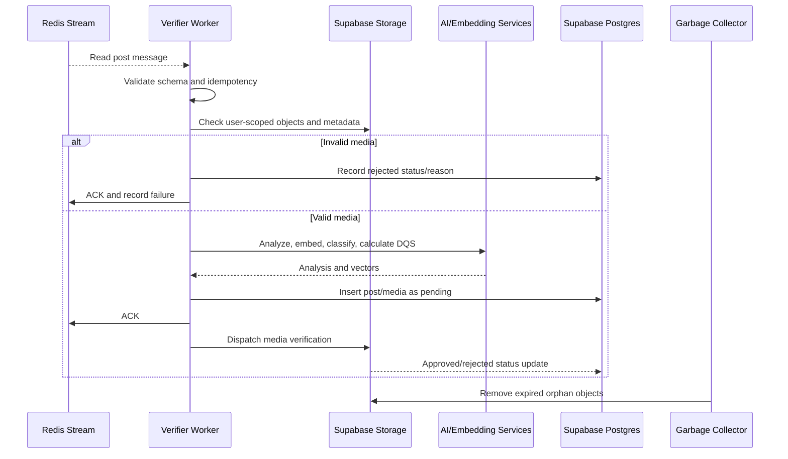

# Post verifier

The verifier is the downstream consumer for `post_creation_stream`. Its
database client is scaffolded, but the worker entrypoint is not implemented:
[`main.py`](main.py) is currently empty. Until a consumer is running, queued
posts are not persisted and pending posts cannot become visible.

## Intended responsibilities

1. Consume Redis Stream messages.
2. Deserialize and validate the request payload.
3. Verify that every media ID belongs to the authenticated user.
4. Confirm the object exists in the expected storage bucket.
5. Detect MIME/type mismatches and unsafe media.
6. Run content analysis, embeddings, topic extraction, and DQS.
7. Insert the post and media rows with `pending` status.
8. Send media to verification and update status to `active` or `rejected`.
9. Acknowledge successful messages and route failures to retry/dead-letter flow.

## Security threats handled by the design

- **Phantom media:** a client submits an ID that was never uploaded.
- **Cross-user media:** a client submits another user's storage object.
- **Malicious media:** uploaded bytes do not match the declared media type.
- **Orphan media:** an uploaded object is never referenced by a post.
- **Replay/duplicate submission:** the same queue message is processed twice.

## Current implementation

Implemented:

- Domain database client scaffold.
- Pending post and media row formatting.
- Redis consumer helper code in the queue client.
- Supabase service client wiring.

Not implemented:

- Runnable worker entrypoint.
- Consumer groups and durable acknowledgements.
- Media existence and MIME verification in the verifier pipeline.
- AI analysis and vector persistence in the verifier.
- Status transitions and garbage collection.

## Verification flow

## TODO

- [ ] Implement `main.py` as a long-running Redis consumer.
- [ ] Use consumer groups, `XREADGROUP`, `XACK`, pending-entry recovery, and
      dead-letter streams.
- [ ] Add media ownership, object existence, MIME sniffing, size, and checksum
      validation.
- [ ] Make database insertion idempotent using a submission/message ID.
- [ ] Add AI analysis and vector persistence to the verifier.
- [ ] Add explicit post/media status transition endpoints or worker logic.
- [ ] Add orphan-media cleanup with an age threshold and audit logging.
- [ ] Add unit, integration, and failure-recovery tests.
